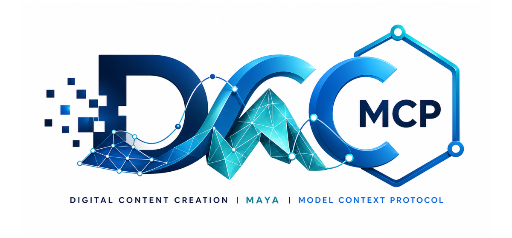
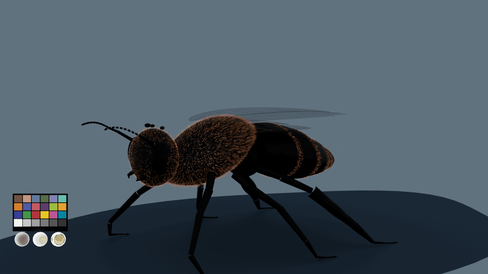
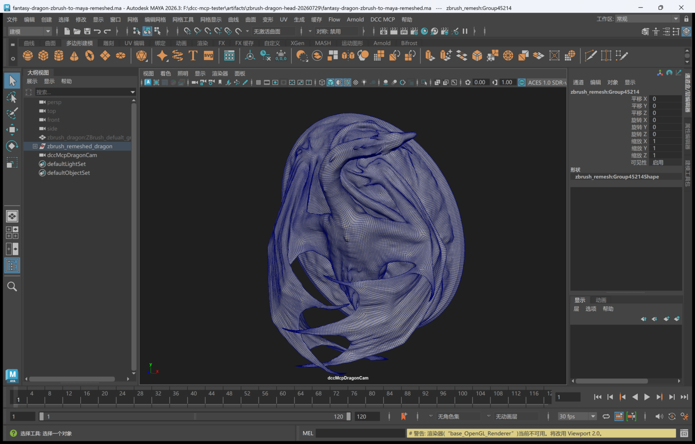
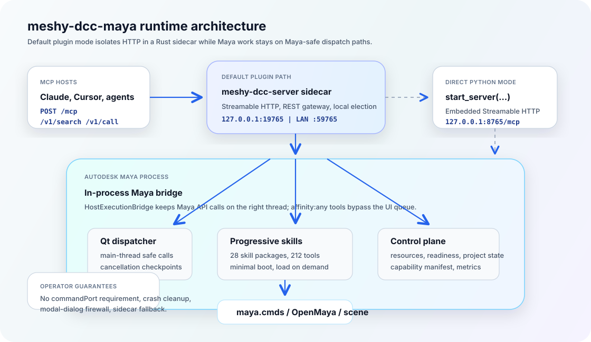

# meshy-dcc-maya

<p align="center">
  
</p>

<!-- meshy-dcc-agent-quickstart:start -->
## Use Maya with AI agents

Install the official Meshy DCC Agent Skill. Codex users can use the native plugin
marketplace:

```powershell
codex plugin marketplace add meshy-dcc/meshy-dcc-agent-plugins
codex plugin add meshy-dcc@meshy-dcc
```

For Claude Code, CodeBuddy, Cursor, Gemini CLI, and other supported agents, use
the [official installation guide](https://github.com/meshy-dev/meshy-dcc-agent-plugins#install). Start Maya,
enable this adapter, and verify that the running instance is registered:

```powershell
meshy-dcc list
```

Then ask your agent:

```text
Use meshy-dcc to inspect the current Maya scene.
```

The list must include `dcc_type=maya`. If it does not, follow the
[connection troubleshooting guide](https://github.com/meshy-dev/meshy-dcc-agent-plugins#adapter-connection-troubleshooting).
<!-- meshy-dcc-agent-quickstart:end -->

<!-- meshy-dcc-coverage-pointer:start -->
<!-- Generated from meshy-dcc-catalog.yml by scripts/generate_adapter_pointer.py in meshy-dcc/meshy-dcc-core. Do not edit by hand. -->
## Part of the Meshy DCC host matrix

**meshy-dcc-maya** — Core Maya adapter for Meshy DCC — gateway-managed instance,
mayapy-based MCP server.

It is one of **47 host adapters** in the Meshy DCC catalog. Every adapter speaks the same
MCP protocol and builds on the same core runtime contract; each one exposes the tools
its own host needs on top of that.

- [All host adapters and install metadata](https://www.meshy.ai/meshy-dcc/ecosystem)
- [Host matrix on the core README](https://github.com/meshy-dev/meshy-dcc-core#readme)
- [Showcase](https://www.meshy.ai/meshy-dcc/showcase)

This block is generated from the catalog entry in
[`meshy-dcc-catalog.yml`](https://github.com/meshy-dev/meshy-dcc-core/blob/main/meshy-dcc-catalog.yml).
Re-run the generator after changing the catalog.
<!-- meshy-dcc-coverage-pointer:end -->

## Agent workflow

AI agents should use the shared gateway through `meshy-dcc`; IDE users may
continue to use the MCP endpoint. Prefer typed skills and tools over raw scripts.

### Install or update the CLI

`meshy-dcc` is the preferred control path for every shell-capable agent. If
it is missing, ask the user before installing the latest official release:

```bash
# Linux/macOS
curl -fsSL https://raw.githubusercontent.com/meshy-dev/meshy-dcc-core/main/scripts/install-cli.sh | sh

# Windows PowerShell
powershell -ExecutionPolicy Bypass -c "irm https://raw.githubusercontent.com/meshy-dev/meshy-dcc-core/main/scripts/install-cli.ps1 | iex"
```

Keep an official build current through the release manifest:

```bash
meshy-dcc update check
meshy-dcc update apply
```

`update apply` downloads and stages the latest CLI for the next launch. It
does not update a running `meshy-dcc-server`; update that server in its own
environment.

```bash
meshy-dcc dcc-types
meshy-dcc list
meshy-dcc search --query "<task>" --dcc-type maya
meshy-dcc describe <tool-slug>
meshy-dcc call <tool-slug> --json '{"key":"value"}'
```

`dcc-types` reports release-catalog support; `list` reports live sessions. If a
tool belongs to an inactive progressive skill, call `meshy-dcc load-skill <skill-name> --dcc-type maya` before retrying. For post-task improvement,
attach a stable session id with `--meta-json`, query `meshy-dcc stats --range 24h --session-id <task-id>`, then pass the bounded evidence to the
`review_skill_improvement` prompt from `meshy-dcc-skills-creator`.


Bring Autodesk Maya to MCP-native AI agents.

`meshy-dcc-maya` turns Maya into a standards-compliant **MCP Streamable HTTP** backend. Agents can inspect scenes, create geometry, edit materials, run animation and render workflows, export assets, and recover project state through typed tools instead of brittle ad-hoc scripts.

The Maya plugin starts a Rust `meshy-dcc-server` sidecar by default, so HTTP and gateway traffic stay isolated from Maya's UI thread while actual Maya API work is routed through Maya-safe dispatchers.

[](https://github.com/meshy-dev/meshy-dcc-maya/actions/workflows/ci.yml)
[](https://codecov.io/gh/meshy-dcc/meshy-dcc-maya)
[](https://github.com/meshy-dev/meshy-dcc-maya/releases)
[](https://github.com/meshy-dev/meshy-dcc-maya/releases)
[](https://github.com/meshy-dev/meshy-dcc-maya/commits/main/)
[](https://github.com/meshy-dev/meshy-dcc-maya/issues)
[](https://github.com/meshy-dev/meshy-dcc-maya/pulls)
[](https://pypi.org/project/meshy-dcc-maya/)
[](https://pypistats.org/packages/meshy-dcc-maya)
[](https://pepy.tech/project/meshy-dcc-maya)
[](https://pypi.org/project/meshy-dcc-maya/)
[](https://www.autodesk.com/products/maya/overview)
[](https://modelcontextprotocol.io/)
[](https://github.com/meshy-dev/meshy-dcc-core)
[](LICENSE)

## Showcase

### Houdini → Maya AssetSync v2



- **Source:** The honeybee model, rig, 96-frame body/wing animation, and groom curves were authored in Houdini. Maya receives the asset through AssetSync v2 `native` mode; `usd_proxy` remains available when USD composition fidelity is more important than native editing.
- **Editable transfer:** The Maya scene retains **61 native joints**, **946 editable animation curves**, and **31,306 native NURBS groom/vein curves**. Four additional tagged NURBS wing controls bring the scene total to **31,310 curves**; each exposes only keyable rotate XYZ channels and drives a native `orientConstraint` plus additive rotation node, preserving the original 96-frame joint curves instead of baking over them. Arnold curve collectors add editable root-to-tip width profiles without replacing the source curves with mesh tubes. Six project-relative 2K texture files drive sRGB Base Color plus Raw roughness/height through native UVs and editable `standardSurface`/`aiStandardHair` nodes. AssetSync inspection reports bounded texture/material connections and explicit controller/constraint editability evidence without guessing from names or counting groom curves as controls.
- **Wing-control proof:** With all four controls neutral, sampled joint world-matrix delta from the source animation is **0.0**. A 10-degree left-front control probe moves its joint, membrane, and vein rig together, then returns all three to **0.0** matrix delta when reset. The four control shapes use distinct viewport offsets while their transforms remain neutral at the wing pivots, and they are excluded from Arnold rendering.
- **Verified Arnold output:** Maya 2026 / Arnold 7.4.3.2 cold renders at **1280×720** on frames 1, 17, 33, 49, 65, and 81 produce six distinct joint-pose hashes. The scene uses ACEScg rendering with the ACES 1.0 SDR-video view, a camera-hidden CC0 [Cloudy Vondelpark HDRI](https://polyhaven.com/a/cloudy_vondelpark), and neutral softboxes. The technical chart changes by at most **1/255** across light variants while all three physical reference spheres respond to the rig. The decoded GIF uses one palette with 24 chart and three reference entries reserved, no dithering, **0/255** temporal chart drift, and at most **1/255** source error.

### ZBrush → Maya round trip



- **Source:** [Artec 3D Fantasy Dragon](https://www.artec3d.com/3d-models/fantasy-dragon), used under CC BY 4.0; the source model is not included in this repository.
- **Processing:** A typed ZBrush-to-Maya round trip verifies the **2,499,970-vertex / 5,000,000-face** source, imports its ZRemesh into an isolated namespace, and enables wireframe-on-shaded inspection.
- **Verified output:** Real Maya 2026 evidence contains the **115,336-vertex / 115,364-face** ZRemesh and a saved scene. See the [full workflow and copyable prompt](https://www.meshy.ai/meshy-dcc/showcase#zbrush-maya-roundtrip).

## Why Use It

| What you get | Why it matters |
|---|---|
| **79+ discoverable typed Maya tools** across 29 bundled skill packages | Agents can call validated tools for scene, mesh, material, animation, rigging, Bifrost, dynamics, render, revisioned Asset Sync, pipeline work, and live tool-development diagnostics. |
| **Progressive loading** | Maya boots with a compact tool surface; agents discover unloaded capabilities and load only what they need. |
| **Sidecar isolation by default** | HTTP/gateway runtime is out of Maya's UI thread, with a Qt dispatcher bridge back into Maya. |
| **Multi-instance gateway** | Run several Maya sessions behind one local MCP URL, with optional LAN gateway exposure. |
| **Operational guardrails** | Readiness probes, project persistence, MCP resources, job persistence, crash cleanup, cancellation, and script-execution lockouts. |

## Quick Start

Agent-assisted setup is available if you want an AI agent to install the
Maya-side dependencies, write MCP host config, and walk you through loading the
plugin:

```text
Help me install meshy-dcc-maya using https://github.com/meshy-dev/meshy-dcc-maya/blob/main/install.md.
```

The agent should follow
[`install.md`](https://github.com/meshy-dev/meshy-dcc-maya/blob/main/install.md),
which delegates the setup workflow to
[`skills/meshy-dcc-maya-setup`](https://github.com/meshy-dev/meshy-dcc-maya/tree/main/skills/meshy-dcc-maya-setup).

Install into Maya's Python. The normal install includes the standard
`meshy-dcc-server` runtime used by the default gateway path:

```bash
mayapy -m pip install meshy-dcc-maya
```

Load the Maya plugin from `maya/plugin/meshy_dcc_maya_plugin.py` with
**Window > Settings/Preferences > Plug-in Manager**. The plugin starts the
Maya bridge, starts or joins the local gateway, and installs the Qt dispatcher
needed by `affinity: main` tools.

Configure your MCP host to the gateway URL:

```json
{
  "mcpServers": {
    "maya": {
      "url": "http://127.0.0.1:19765/mcp"
    }
  }
}
```

Smoke test from your MCP host:

```text
Search for Maya tools, load the maya-primitives skill, and create a cube.
```

For auto-start, copy or source the bundled `maya/userSetup.py`. It defers
plugin loading until Maya is idle and uses the same gateway path as the
Plug-in Manager.

Direct `start_server()` uses an OS-assigned instance port. In Maya GUI, pass a
UI dispatcher explicitly:

```python
from meshy_dcc_maya.dispatcher import MayaUiDispatcher, MayaUiPump
import meshy_dcc_maya

dispatcher = MayaUiDispatcher()
MayaUiPump(dispatcher).install()
handle = meshy_dcc_maya.start_server(host_dispatcher=dispatcher)
print(handle.mcp_url())  # Exact direct endpoint selected by the OS
```

Connect through the stable gateway on `19765`, or use the printed URL for an
explicit direct debugging connection.

### Headless Mayapy

Start a new standalone instance through Maya's official Python executable:

```bash
mayapy -m meshy_dcc_maya --port 0 --gateway-port 19765 --json
```

The CLI requires Core 0.20.0 or newer, initializes Maya, pumps Core's dispatcher on the owning main thread,
and uninitializes Maya on shutdown. The startup JSON reports the actual host
PID and direct MCP endpoint; the gateway discovers this standalone instance.
Use repeated `--skill-path` arguments to load project skills and
`--registry-dir` to select an isolated registry. The existing `meshy-dcc-maya`
console command continues to manage installation.

For an already initialized batch interpreter, call
`meshy_dcc_maya.serve_headless(stop_event=...)` from the main thread. The caller
owns Maya initialization and the stop event; the function owns its server and
dispatcher. GUI sessions use the plugin or `start_server()` with a UI dispatcher.

## Architecture

<p align="center">
  
</p>

The default plugin path is:

1. MCP host connects to the standalone gateway at `http://127.0.0.1:19765/mcp`.
2. Each Maya plugin starts a per-DCC `meshy-dcc-server sidecar`; the sidecar ensures the machine-wide gateway is running and registers this Maya as a backend.
3. The sidecar calls back into Maya through the Qt event-loop dispatcher.
4. `MayaMcpServer` routes work to typed skills, resources, project tools, readiness, metrics, and the Maya API.

Set `MESHY_DCC_MAYA_SIDECAR=0` before loading the plugin to use the legacy in-process gateway path. Newer sidecar binaries also expose the standalone gateway on the LAN at `http://<this-machine-lan-ip>:59765/mcp`; set `MESHY_DCC_GATEWAY_REMOTE_PORT=0` to disable that listener. Maya passes explicit sidecar labels (`Maya <version> pid <pid>`), stable `instance_id`, and a machine-level gateway name (`MESHY_DCC_GATEWAY_NAME` or `meshy-dcc-gateway@<hostname>`) so `/admin`, `/health`, and CLI `list` can separate gateway ownership from Maya sessions.

## Tool Surface

Default startup is intentionally small: `maya-scripting` and the core `maya-scene` group are available immediately, while other skills stay discoverable through `dcc_capability_manifest`, `search_skills`, and `search_tools`.

| Stage | Purpose | Skills |
|---|---|---|
| `bootstrap` | Escape hatch when no typed skill fits | `maya-scripting` |
| `scene` | Scene lifecycle, DAG, attributes, node graph, viewport display | `maya-scene`, `maya-scene-assembly`, `maya-display`, `maya-attributes`, `maya-node-graph` |
| `authoring` | Meshes, UVs, materials, rigs, animation, Bifrost, dynamics, expressions, lighting | `maya-primitives`, `maya-mesh-ops`, `maya-uv-ops`, `maya-materials`, `maya-material-library`, `maya-texture-bake`, `maya-rigging`, `maya-animation`, `maya-dynamics`, `maya-bifrost`, `maya-pose-library`, `maya-expressions`, `maya-light-rig` |
| `interchange` | Geometry, scene I/O, and revisioned cross-DCC sync | `maya-geometry`, `maya-asset-sync`, `maya-export-preset` |
| `pipeline` | Project, publish, shot export, render, render farm, development diagnostics | `maya-dev`, `maya-pipeline`, `maya-shot-export`, `maya-render`, `maya-render-farm` |

Typical agent flow:

```text
search_skills / dcc_capability_manifest
  -> load_skill("maya-primitives")
  -> maya_primitives__create_sphere(...)
  -> activate_group("extended") only when optional tools are needed
```

`execute_python` and `execute_mel` remain available as escape hatches, while common plug-in lifecycle work should use `maya_scripting__list_plugins`, `maya_scripting__load_plugin`, and `maya_scripting__unload_plugin`. Production deployments can block arbitrary execution with `MESHY_DCC_MAYA_DISABLE_EXECUTE_PYTHON=1`, `MESHY_DCC_MAYA_DISABLE_EXECUTE_MEL=1`, or `MESHY_DCC_MAYA_DISABLE_ARBITRARY_SCRIPT=1`.

See [`src/meshy_dcc_maya/skills/SKILLS_INDEX.md`](src/meshy_dcc_maya/skills/SKILLS_INDEX.md) for task-to-skill routing examples and [`docs/guide/mcp-tools.md`](docs/guide/mcp-tools.md) for a user-facing tool map.

## Runtime Features

| Feature | Surface |
|---|---|
| Capability manifest | `dcc_capability_manifest({"loaded_only": false})` returns a compact index of loaded and unloaded Maya actions without full schemas. |
| MCP resources | `scene://current`, `maya-cmds://help/<command>`, `maya-cmds://flags/<command>`, `maya-api://signatures/<class>`, `maya-project://current`. |
| Readiness | `/v1/readyz` reports `process`, `dispatcher`, and `dcc` readiness before orchestration routes work to Maya. |
| Project state | `project_save`, `project_load`, `project_resume`, and `project_status` persist state under `<scene_dir>/.meshy-dcc/project.json`. |
| Job persistence | Optional SQLite-backed job storage with `MESHY_DCC_MAYA_JOB_STORAGE` and `MESHY_DCC_MAYA_JOB_RECOVERY=requeue`. |
| Shutdown hardening | Maya exiting hook, `atexit`, process sentinel, and optional defensive finalizer reduce stale registry rows. |
| Safe sessions | MCP-dispatched Maya jobs suppress blocking modal dialogs and snooze AutoSave unless opted out. |
| Metrics | Optional Prometheus `/metrics` endpoint via `MESHY_DCC_MAYA_METRICS=1`. |
| Dev workflow | `maya-dev` can attach a local Python tool project, hot-reload modules, run entrypoints/scripts, start debugpy, and capture Maya UI evidence. |

## Installation

### PyPI

```bash
mayapy -m pip install meshy-dcc-maya
```

### Maya Module ZIPs

Release module archives bundle the Maya plugin, `meshy-dcc-maya`, and the
in-process Python bridge dependencies such as `meshy-dcc-core`, plus the
`meshy-dcc-server` sidecar binary used by the default plugin gateway mode.
Each archive includes `module-info.json` with `adapter_version`,
`embedded_core_version`, and `bundled_server_version` so release smoke reports
can distinguish the Maya adapter, embedded core runtime, sidecar server, and
external CLI/gateway versions. `embedded_core_version` is intentionally pinned
to `0.19.4` while Maya 2022/Python 3.7 compatibility is maintained.
Clean-machine verification:

```bash
mayapy -c "from meshy_dcc_maya.sidecar import resolve_sidecar_binary; print(resolve_sidecar_binary())"
```

Set `MESHY_DCC_SERVER_BIN` only when you want to override the bundled sidecar
executable. Set `MESHY_DCC_MAYA_SIDECAR=0` before loading the plugin to use the
legacy in-process gateway path.

### Maya Plugin

1. Put `maya/plugin/meshy_dcc_maya_plugin.py` on `MAYA_PLUG_IN_PATH`.
2. Load it from **Window > Settings/Preferences > Plug-in Manager**.
3. Point your MCP host at `http://127.0.0.1:19765/mcp`.

For auto-start, copy or source the bundled `maya/userSetup.py`. If you maintain
your own `userSetup.py`, queue the load on Maya's deferred command queue:

```python
import maya.cmds as cmds

cmds.evalDeferred(
    lambda: cmds.loadPlugin("meshy_dcc_maya_plugin", quiet=True),
    lowestPriority=True,
)
```

Prefer `cmds.evalDeferred` to `maya.utils.executeDeferred` for start-up
auto-load. `maya.utils.executeDeferred` runs on Maya's **idle event loop**,
which only fires once the main thread actually goes idle; during a GUI
start-up that may never happen, and the plug-in silently never loads.

Never pass `lowestPriority` to `maya.utils.executeDeferred` either: it forwards
extra keyword arguments to the callable, so the load callback raises
`TypeError` inside Maya's deferred dispatcher and fails with no visible error.
`cmds.evalDeferred` treats `lowestPriority` as the scheduling flag it is.

When you copy or source the bundled `maya/userSetup.py`, a failed auto-load is
written to the Script Editor, Maya's status line, and
`<MESHY_DCC_MAYA_BOOTSTRAP_ERROR_DIR>` (default
`~/.meshy-dcc/receipts/bootstrap-errors/`). A hand-written `userSetup.py` like
the snippet above only gets the plug-in's own Script Editor / status-line
report, because the JSONL record is written by the bundled file.

Useful plugin defaults:

| Mode | URL |
|---|---|
| Plugin standalone gateway | `http://127.0.0.1:19765/mcp` |
| Optional LAN gateway | `http://<this-machine-lan-ip>:59765/mcp` |
| Direct `start_server()` | OS-assigned; inspect `handle.mcp_url()` |

## Configuration

| Environment variable | Default | Description |
|---|---|---|
| `MESHY_DCC_MAYA_PORT` | `0` | TCP instance port; `0` lets the OS choose. |
| `MESHY_DCC_MAYA_SERVER_NAME` | `maya-mcp` | Name shown in MCP `initialize`. |
| `MESHY_DCC_MAYA_SKILL_PATHS` | none | Maya-specific skill search roots (`;` on Windows, `:` on Unix); each root can be a single skill package or contain child skill packages. |
| `MESHY_DCC_SKILL_PATHS` | none | Global fallback skill search roots for all DCC adapters. |
| `MESHY_DCC_MINIMAL` | `1` | `0` loads the full tool surface at startup. |
| `MESHY_DCC_DEFAULT_TOOLS` | none | Comma-separated skill names to load at startup. |
| `MESHY_DCC_MAYA_EXCLUDE_STUBS_FROM_TOOLS_LIST` | `0` | Hide `__skill__*` / `__group__*` stubs from large `tools/list` syncs. |
| `MESHY_DCC_MAYA_SIDECAR` | `1` | `0` disables the default plugin sidecar process. |
| `MESHY_DCC_SERVER_BIN` | auto | Override the `meshy-dcc-server` binary path. |
| `MESHY_DCC_GATEWAY_PORT` | `19765` plugin | Local standalone gateway port; `0` disables gateway mode. |
| `MESHY_DCC_GATEWAY_NAME` | `meshy-dcc-gateway@<hostname>` sidecar | Human-readable gateway label shown in admin and CLI diagnostics. |
| `MESHY_DCC_GATEWAY_REMOTE_PORT` | `59765` sidecar | LAN gateway listener port; `0` disables remote access. |
| `MESHY_DCC_GATEWAY_REMOTE_HOST` | `0.0.0.0` | Bind address for the LAN gateway listener. |
| `MESHY_DCC_REGISTRY_DIR` | OS temp dir | Shared FileRegistry directory for service discovery. |
| `MESHY_DCC_MAYA_ENABLE_GATEWAY_FAILOVER` | `1` | Allow non-gateway instances to promote themselves on gateway loss. |
| `MESHY_DCC_MAYA_ENABLE_WORKFLOWS` | `0` | Enable core workflow tools. |
| `MESHY_DCC_MAYA_PROJECT_TOOLS` | `1` | `0` disables `project.*` MCP tools. |
| `MESHY_DCC_MAYA_RESOURCES` | `1` | `0` disables MCP resource publishing. |
| `MESHY_DCC_MAYA_READINESS_TIMEOUT_SECS` | none | Advisory timeout value for readiness consumers. |
| `MESHY_DCC_MAYA_METRICS` | `0` | `1` enables Prometheus `/metrics`. |
| `MESHY_DCC_MAYA_JOB_STORAGE` | `<data_dir>/jobs.db` | SQLite job persistence path; set `""` to disable. |
| `MESHY_DCC_MAYA_JOB_RECOVERY` | `drop` | `requeue` resumes idempotent interrupted jobs. |
| `MESHY_DCC_MAYA_HOT_RELOAD` | `0` | `1` watches skills for disk changes. |
| `MESHY_DCC_MAYA_DEV_ROOTS` | none | Optional path-list of trusted roots that `maya-dev` projects must live under. |
| `MESHY_DCC_MAYA_FAULTHANDLER` | `1` | `0` disables fatal-signal traceback logging from the Maya plugin. |
| `MESHY_DCC_MAYA_SUPPRESS_CRASH_REPORTER` | `0` | `1` suppresses Maya crash reporter dialogs during unattended startup. |
| `MESHY_DCC_MAYA_AUTO_DISMISS_CRASH_DIALOG` | `0` | `1` auto-dismisses detected Maya Qt recovery dialogs after main-thread tool calls and surfaces `maya_recovered` in results/context. |
| `MESHY_DCC_MAYA_DISABLE_AUTOSAVE` | `1` | `0` opts out of the plugin's AutoSave suppression during MCP jobs. |
| `MESHY_DCC_MAYA_SAFE_SESSION` | `1` | `0` disables the modal-dialog firewall around MCP-dispatched jobs. |
| `MESHY_DCC_MAYA_DISABLE_EXECUTE_PYTHON` | `0` | Refuse `execute_python`. |
| `MESHY_DCC_MAYA_DISABLE_EXECUTE_MEL` | `0` | Refuse `execute_mel`. |
| `MESHY_DCC_MAYA_DISABLE_ARBITRARY_SCRIPT` | `0` | Refuse both arbitrary Python and MEL execution. |

### Studio Skill Paths and Rez

`MESHY_DCC_MAYA_SKILL_PATHS` is read during server registration/startup and is
split with the platform path separator (`;` on Windows, `:` on Linux/macOS).
Each entry is a skill search root. The scanner accepts either a single skill
package directly or a directory whose immediate children are skill packages:

```text
studio_maya_skills/
└── skills/
    ├── lightbox-maya-dev/
    │   ├── SKILL.md
    │   ├── tools.yaml
    │   └── scripts/
    └── shot-publish/
        ├── SKILL.md
        └── scripts/
```

Rez packages should append the `skills` root in `package.py`:

```python
def commands():
    env.MESHY_DCC_MAYA_SKILL_PATHS.append("{root}/skills")
```

`load_skill("lightbox-maya-dev")`, `search_skills`, the gateway `/v1/search`,
and `dcc_capability_manifest` operate on the skills discovered at registration
time. If a Rez context or environment variable changes after Maya has started,
restart/reload the plugin or start the server again so the adapter rescans the
new roots; `load_skill` activates an already discovered skill, but it does not
rescan newly added environment paths.

## Authoring Skills

Skill scripts should lazy-import `maya.cmds` inside the callable so packages can be discovered without a running Maya:

```python
from meshy_dcc_maya.api import maya_success, with_maya


@with_maya
def create_sphere(radius: float = 1.0) -> dict:
    import maya.cmds as cmds

    result = cmds.polySphere(radius=radius)
    return maya_success("Created sphere", object_name=result[0])
```

Every `tools.yaml` entry must declare execution mode and thread affinity:

```yaml
tools:
  - name: playblast
    description: Capture a viewport playblast
    execution: async
    affinity: main
    timeout_hint_secs: 600

  - name: list_export_presets
    execution: sync
    affinity: any
```

Use `affinity: main` for anything touching `maya.*` or scene state. Use `affinity: any` only for pure Python or filesystem work. CI enforces this with `tools/lint_skill_affinity.py`.

Long-running loops should poll cancellation:

```python
from meshy_dcc_maya import check_maya_cancelled, maya_success


def render_frames(frames):
    for frame in frames:
        check_maya_cancelled()
        cmds.currentTime(frame)
        cmds.render()
    return maya_success("Rendered frames", frames=len(frames))
```

## Documentation

- [Getting started](docs/guide/getting-started.md)
- [Installation](docs/guide/installation.md)
- [Standalone mayapy services](docs/guide/standalone.md)
- [Local MCP + debug](docs/guide/local-mcp-debug.md)
- [Multi-instance deployment](docs/guide/multi-instance.md)
- [MCP resources](docs/guide/mcp-resources.md)
- [Tool inventory](docs/guide/mcp-tools.md)
- [Shutdown matrix](docs/guide/shutdown-matrix.md)
- [API reference](docs/api/server.md)

## Development

```bash
git clone https://github.com/meshy-dev/meshy-dcc-maya
cd meshy-dcc-maya
pip install -e ".[dev]"
pytest tests/
```

Common development commands:

```bash
just verify-deps
just test-quick
just maya-link
just maya-install-core maya-py=/path/to/mayapy
```

Windows PowerShell helpers:

```powershell
just maya-link-win
just maya-install-core-win maya-version=2025
just maya-status-win
just maya-unlink-win
```

Windows symlinks require Developer Mode or an elevated shell. If symlinks are unavailable, the helper scripts fall back to copying files.

## Requirements

- Autodesk Maya 2020+
- Python 3.7+
- `meshy-dcc-core>=0.20.0,<0.21.0` (Asset Sync tools feature-detect `meshy_dcc_core.asset_sync` at call time)
- Standard sidecar binary for plugin mode: `meshy-dcc-server>=0.18.21`

## License

MIT - see [LICENSE](LICENSE).
